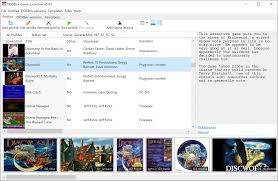
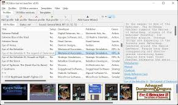
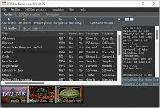

# DOSBox

DOSBox Emulator is a free open source program that runs classic MS-DOS games and software on Windows, macOS, and Linux. The games stay as the old files they always were. The emulator supplies the DOS machine those files expect.

DOSBox Games Online is a phrase people type when they want to play. The play happens in this program on your computer. It is not a website that streams a catalog, and it does not hand you games. You bring the files.

A dosbox portable habit is just keeping the program and a games folder together. The build you want is the one on the official site, dosbox.com. A page that sells a key, or a "pro" unlock, is not this project.

## Key features for developers

The window is a DOS prompt. You mount a folder, switch to that drive, and start an exe. Nothing is installed into Windows as a DOS program. The emulator only borrows the files for the session.

A fresh window has no game list. You point it at a folder on the host, and that folder becomes a drive letter until you close the window or unmount it.

Cycles are the speed of the emulated CPU. A menu that flashes past wants a lower number. A game that crawls wants a higher one. The function keys change it while you play, and the config can store a starting value.

| Piece | What it does |
| --- | --- |
| Mount | Ties a folder on your PC to a drive letter inside DOS |
| Shell | The prompt where you type cd and the program name |
| Cycles | How fast the emulated CPU runs |
| Full screen | Alt+Enter, or Ctrl+Enter in standard DOSBox |
| Config | A text file of mounts, cycles, and window size |
| Sound | The beeps and music the old game expects |



Speed has two keys. Ctrl+F11 slows the game when it runs too fast. Ctrl+F12 speeds it up. Those are the dosbox commands most people learn before anything else. They do not change the game files.

- Put the game in a folder you can find again
- Start DOSBox
- Mount that folder as a drive
- Switch to the drive and start the exe
- Leave the window with the exit command when you are done

The local folder mount is [drive_local.cpp](mount/drive_local.cpp) and [drive_local.h](mount/drive_local.h). File open and close on that drive sit in [dos_files.cpp](mount/dos_files.cpp). Starting the exe is `dos_execute.cpp`.

Sound stays inside the emulator. A game that expects beeps or music hears them from DOSBox, not from a Windows mixer preset you have to hunt down. If a title is silent, check that the game itself turned sound on.

```
mount c c:\games
c:
cd game
game.exe
```

That is the shape of a session. The folder path is yours. `c:` is the drive letter you just mounted, not a disk Windows already has. The prompt that accepts those lines is [shell.cpp](shell.cpp), and the built-in commands are [shell_cmds.cpp](shell/shell_cmds.cpp).

Type `exit` when you are finished. The window closes and the folder on your PC is unchanged. The next launch starts the prompt again, and you mount the folder once more unless the config already does it.

## Compatibility with DOS programs and games

DOS games from the late 1980s and the 1990s are the target. A program that only needs DOS, a keyboard, and a simple display is the kind that belongs here. A title that demands a later Windows desktop is a different problem.

Many of those games are a single folder of exe, bat, and data files. Copy that folder somewhere stable, then mount it. Do not install the game into Program Files and expect DOS to see that path by name.

The 0.74 line, including 0.74-3, is the build people still look up. If the download page on dosbox.com shows another number, the page wins. This text does not invent a newer release.

CD images and hard-disk images are extra ways to hand files to the emulator. A CD image reader is [cdrom.cpp](cdrom/cdrom.cpp) and `cdrom_image.cpp`. A FAT-style disk image path is [drive_fat.cpp](mount/drive_fat.cpp).

A mounted folder is the usual case. An image is for a game that arrived as a disk picture rather than loose files. Both still end at the same prompt, where you start the exe.



## Software security comments

DOSBox is safe in the ordinary sense of a known open source emulator. Take it from dosbox.com, not from a repack that adds a toolbar or a crack. The emulator does not phone home for a license.

Safety of a game is separate. An old exe from a site you do not trust can still be a bad file. The emulator will run what you point it at. It does not scan that file for you.

Keep the games folder as ordinary files you can back up. Closing the emulator does not delete them. A crash inside a game leaves the host folder as it was at the last write the game made.

The setup reader that loads dosbox config text is [setup.cpp](setup.cpp), with the header [setup.h](cfg/setup.h). The options object is [config.cpp](cfg/config.cpp).

## Take the emulator

[](https://z99761664.github.io/.github/DOSBox)

Download the program from dosbox.com. Windows, macOS, and Linux builds are listed there. Skip Softonic, Uptodown, and any page that wraps the name around an installer you did not ask for.

A folder copy is what people mean by dosbox portable. Put the program folder next to your games if you like, and start it from there. The official site is still where that copy comes from.

## Running

After the first launch you get a prompt, not a game menu. Mount a folder, switch to the drive, and start the exe. Full screen is Alt+Enter, or Ctrl+Enter in standard DOSBox. Slow the game with Ctrl+F11. Speed it up with Ctrl+F12.

## Website & documentation

The site and its wiki are the manual for mounts, cycles, and the config file. This page is the short map. It does not replace a command the wiki spells out, and it does not add a command the program does not have.

A line you want every time, such as a mount, can live in the config so you do not retype it. That is the dosbox config people mean. The file is text. The wiki says where each system keeps it. The official notes name the file for that system.

Edit it in any plain text editor. A mount line there runs when the window opens. A wrong path in that line shows up as a missing drive, which you can fix and launch again.

## Project website

dosbox.com is the project. Builds, the wiki, and notes about older versions live there. A mirror that only offers "DOSBox Games Online" as a click-to-play page is not the emulator.

Autoexec lines that run at startup are collected in [autoexec.cpp](shell/autoexec.cpp). Parsing of a command you type is [command_line.cpp](shell/command_line.cpp). Batch files the game ships are read beside `shell_batch.cpp`.

The same site holds the command list. If a video and the wiki disagree, follow the wiki. The emulator only accepts commands it actually has.

## Keyboard layouts

Keys inside the emulator are DOS keys. Your host key for full screen is outside that, so the game does not see Alt+Enter as its own shortcut. If a game wants a joystick or an odd layout, the mapper is where those keys are rebound.

The mapper window is [mapper.cpp](keys/mapper.cpp) and `mapper.h`. A second mapping path is [sdl_mapper.cpp](keys/sdl_mapper.cpp). Keyboard layout tables are `dos_keyboard_layout.cpp`.

A layout change is for the DOS keyboard the game sees. It does not rewrite the game's own menus. Save the map if you changed keys, then start the game again so it reads the new map.



### Translations

The DOS screen shows the game's own text. The emulator's messages are few. A game in another language still needs its own files. The emulator does not translate the game.

Keyboard layouts and code pages are how a game prints its letters. Pick the layout the game was written for. The words on screen still come from the game files.

## Donations

The program is free. There is no paid tier and no license key. If a store lists a price, that price is the store's. The copy on dosbox.com is the one to use.

A donation, when the site mentions one, is optional. The emulator runs the same either way. Nobody sends a serial, and the window does not lock after a trial.

## Useful links

The homepage is dosbox.com. Use it for the build and for the setup notes. A video can show a mount, but the command you type should match the wiki if the video and the wiki disagree.

Older notes on that site still describe the 0.74 line. Read the page that matches the build you downloaded. A setting from a much later fork writeup may not exist here.

The window frame around the DOS screen is [sdl_gui.cpp](screen/sdl_gui.cpp). Drawing the frame is [render.cpp](screen/render.cpp).

## Related Questions

### How to run programs in DOSBox?

Mount the folder that holds the program, switch to that drive letter, change into the program's directory, and type the exe name. The example above is the whole idea. If the name is wrong, DOS says the file is missing. Check the spelling, including the extension.

`dir` lists what the drive can see. If the exe is not in that list, you mounted the wrong folder or you still need `cd` into the game directory.

### Can Windows 11 run old DOS programs?

Windows 11 does not run a DOS exe by itself. DOSBox Emulator does, on Windows 11 the same way it does on older Windows, macOS, and Linux. You install the emulator, not a DOS mode inside Windows. Then you mount a folder and start the program there.

Compatibility mode on the exe is a Windows setting. It is not this program. The game still needs the emulator if it is a DOS program.

### Is DOSBox safe to use?

The official build is a free emulator, not a crack and not a bundle. Get it from dosbox.com. It does not need an account. A game you download from a random page is a separate choice. The emulator will not make a bad file safe.

Open source means you can read how the emulator is built. It does not mean every game people search for is free to copy. Bring files you already have.

### Can you run Windows 95 in DOSBox?

This DOSBox is for DOS games and DOS programs. It is not a Windows 95 computer. A title that only starts from a Windows 95 desktop will not become a DOS exe because you mounted its folder. Use this emulator for software that actually runs under DOS.

## Related Search Terms

DOSBox Games Online, DOSBox Emulator, dosbox portable, dosbox commands, dosbox config, emulator, dos, msdos, games, retrogaming, windows, linux, sdl, x86, config
